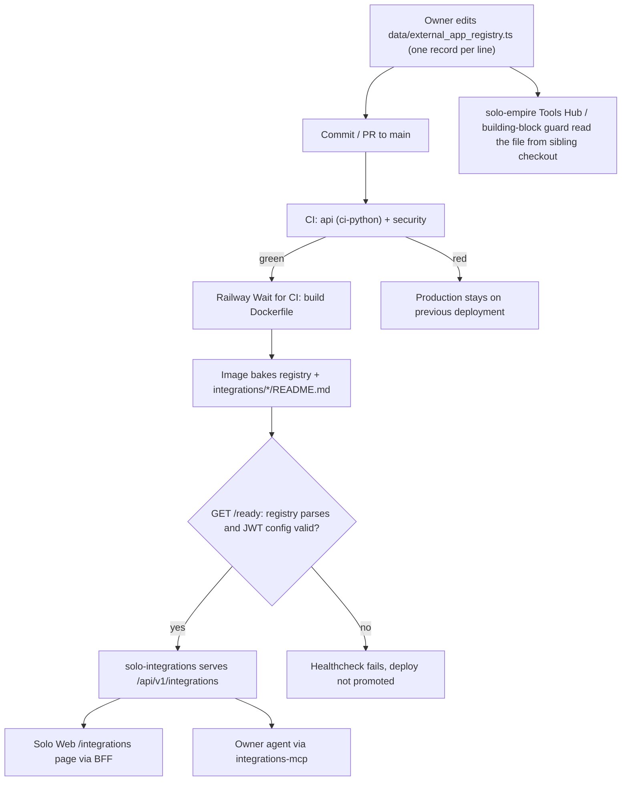

# 01 — Business process (As-Is / To-Be)

repo นี้คือ **read-only projection** ของทะเบียนแอปภายนอก (`data/external_app_registry.ts`) เป็น JSON ให้หน้า `/integrations` ของ Solo Web และให้ agent ผ่าน MCP (`integrations.list`) — ไม่เก็บ credential, ไม่เรียก provider, ไม่มี database

## As-Is (จากโค้ดวันนี้)

Sources: `README.md`, `PRODUCT.md`, `server.py`, `Dockerfile`, `railway.toml`, `.railway/railway.ts`, `.github/workflows/ci.yml`, `integrations_mcp.py`

ขั้นตอนธุรกิจหลักคือ "ดูว่าระบบเชื่อมกับแอปไหนแล้ว / แค่วางแผนไว้" — status มี 4 ค่า (`live`, `mcp_only`, `paused`, `planned`) ตาม `STATUS_DEFINITIONS` ใน `server.py`; การ promote `planned` ต้องมี credential folder, data contract, rate-limit, redaction, idempotent sync และ test ก่อน (`docs/EXTERNAL-APP-REGISTRY.md`) — แต่ขั้นนี้ทำนอก repo นี้

## To-Be (จากเอกสารใน repo เท่านั้น)

- `specs/001-l2-baseline/spec.md` (SPEC-001) เป็นงาน tooling/test ที่ implement แล้ว ไม่เพิ่ม endpoint; review 2026-10-24 ขอแก้ตาราง §4
- PR #1 (open, `feat: expose platform channels and owner connection observations`) เป็น To-Be ที่ยังไม่ merge — ยังไม่มีใน spec/PRODUCT.md
- `DOCPACK/00-product-card.md` §8: "ตัดสินใจ deploy หรือคงเป็นไฟล์ทะเบียน" (ล้าสมัยแล้ว: deploy แล้ว) และ "เพิ่ม CI" (ทำแล้ว)

ไม่มี `docs/UPGRADE-PLAN.md`; To-Be ระดับ process จึงเป็น open question

## Open questions

- PR #1 จะ merge หรือปิด? ถ้า merge จะเปลี่ยน API จาก registry-only เป็นมี "owner connection observations"
- PRODUCT.md "Measures" ยังไม่มี target ของสัดส่วน `live`/`mcp_only` และ guide coverage (`[ต้องยืนยัน]`)
