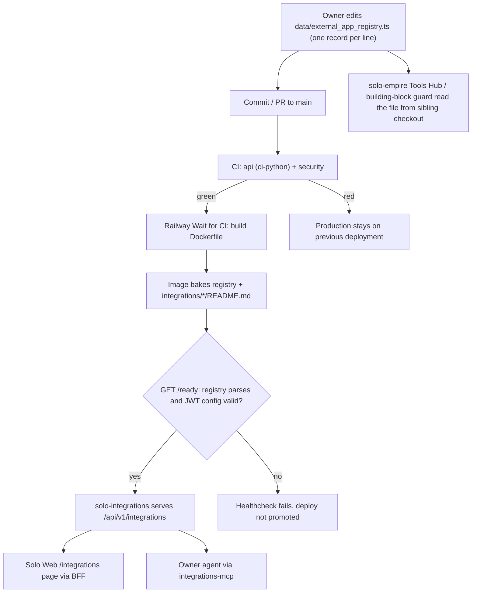

# 01 — Business process (As-Is / To-Be)

repo นี้คือ **read-only projection** ของทะเบียนแอปภายนอก (`data/external_app_registry.ts`) เป็น JSON ให้หน้า `/integrations` ของ Solo Web และให้ agent ผ่าน MCP (`integrations.list`) — ไม่เก็บ credential, ไม่เรียก provider, ไม่มี database

Last reviewed: 2026-11-27 · commit `1718300`

## As-Is (จากโค้ดวันนี้)

Sources: `README.md`, `PRODUCT.md`, `server.py`, `Dockerfile`, `.railway/railway.ts`, `.github/workflows/ci.yml`, `integrations_mcp.py`

ขั้นตอนธุรกิจหลักคือ "ดูว่าระบบเชื่อมกับแอปไหนแล้ว / แค่วางแผนไว้" — status มี 4 ค่า (`live`, `mcp_only`, `paused`, `planned`) ตาม `STATUS_DEFINITIONS` ใน `server.py`; การ promote `planned` ต้องมี credential folder, data contract, rate-limit, redaction, idempotent sync และ test ก่อน (`docs/EXTERNAL-APP-REGISTRY.md`) — แต่ขั้นนี้ทำนอก repo นี้

## To-Be

ไม่มี To-Be ที่เขียนไว้ (ไม่มี `docs/UPGRADE-PLAN.md`; `specs/001-l2-baseline` เป็นงาน tooling/test ที่ implement แล้ว status in review, owner approval pending)

PR #1 (`feat: expose platform channels and owner connection observations`) ถูกปิดโดยไม่ merge เมื่อ 2026-11-04 (ตรวจจาก GitHub) จึงไม่นับเป็น To-Be

## Gap

| ID | As-Is → To-Be | Status | Owner | Evidence |
|---|---|---|---|---|
| G1 | ไม่มี To-Be ระดับ process → To-Be ที่ owner เขียนไว้ (เช่น API ยังเป็น registry-only หรือเพิ่ม owner connection observations) | decide | owner | PR #1 closed 2026-11-04 (unmerged); `PRODUCT.md` |
| G2 | Measures ไม่มี target ของสัดส่วน `live`/`mcp_only` และ guide coverage → กำหนด target | decide | owner | `PRODUCT.md` Measures ([ต้องยืนยัน]) |
| G3 | `DOCPACK/00-product-card.md` §8 ยังเขียน "ตัดสินใจ deploy" และ "เพิ่ม CI" ทั้งที่ deploy และมี CI แล้ว → แก้ product card | todo | claude | `.github/workflows/ci.yml`; `PRODUCT.md` Operating Context |
| G4 | SPEC-001 status in review → owner approval | decide | owner | `specs/001-l2-baseline/spec.md` |

## Open questions

- ถ้าจะเพิ่ม owner connection observations ให้ API ต้องเปลี่ยนจาก registry-only เป็นอะไร (ผูกกับ G1)
