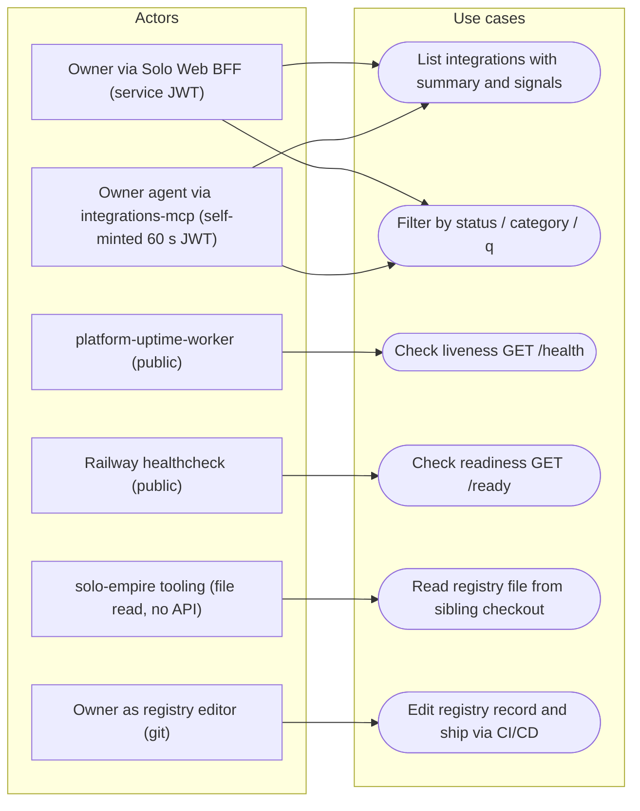

# 02 — Use cases

Actors มาจาก auth ในโค้ด: public (ไม่มี token) เรียกได้แค่ `/health` `/ready`; owner ต้องมี RS256 JWT `aud=integrations-api`, `scope=integrations:read`, `tenant_id=owner`, `sub` อยู่ใน allowlist (`vendor/service-auth`, `server.py`)

Sources: `server.py` (`handle`, `_overview`, `_check_read_auth`), `vendor/service-auth/service_auth/__init__.py`, `integrations_mcp.py` (`integrations.list`, `mint`), `.railway/railway.ts` (`healthcheckPath = "/ready"`), `PRODUCT.md` (Users), platform-uptime-worker `src/targets.ts` @ `57f0afb` (`integrations-api` → `/health`)

| Use case | Actor | Auth | Result |
|---|---|---|---|
| List / filter | Owner (BFF), agent (MCP) | RS256 JWT ≤ 120 s | 200 JSON, 400 `invalid_field`, 401/403, 503 |
| `/health` | uptime worker, anyone | none | 200 `status: ok` |
| `/ready` | Railway healthcheck | none | 200 / 503 `not_ready` |
| Write methods | anyone | JWT checked first | 405 `method_not_allowed` |

## Open questions

- gateway `routes.json` (platform-api-gateway @ `1f02c2a`) มี route `integrations` → service นี้; ยังไม่ยืนยันว่ามี caller ใช้ทางนั้นจริง และ token ที่ผ่าน gateway มี `iss` ตรงกับ `INTEGRATIONS_API_AUTH_ISSUER` (Solo Web origin) หรือไม่
