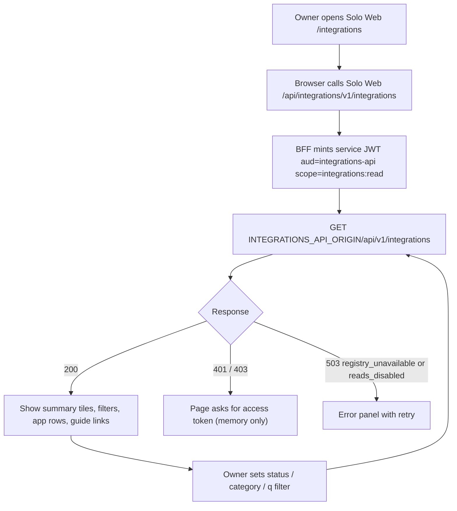
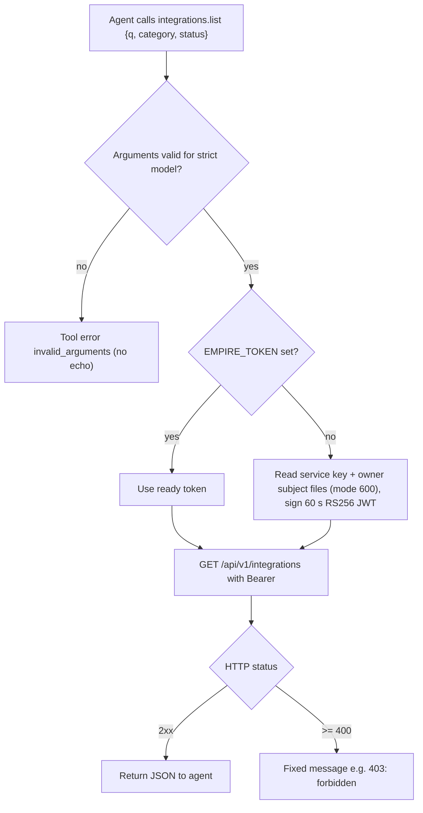
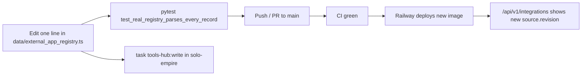

# 03 — User flows

ไม่มี UI ใน repo นี้; UI อยู่ที่ Solo Web (`bookchaowalit/life-dashboard-web` `modules/integrations/client.tsx`) flow ด้านล่างคือ journey ที่วิ่งผ่าน API นี้

## Flow A — Owner เปิดหน้า /integrations ใน Solo Web

Sources: life-dashboard-web @ `17159a9`: `lib/backends.ts` (`integrations`, `INTEGRATIONS_API_ORIGIN`, route `^v1/integrations$`), `lib/auth.ts` (audience/scope), `app/api/[service]/[...path]/route.ts`, `modules/integrations/client.tsx`; this repo: `server.py`, `contracts/integrations.v1.md`

## Flow B — Agent ใช้ MCP tool `integrations.list`

Sources: `integrations_mcp.py` (`StrictMCPServer.call_tool`, `Toolbox.call`, `mint`, `failure`), `.mcp.json`, `tests/test_mcp.py`

## Flow C — Owner แก้ทะเบียน

Sources: `README.md`, `tests/test_server.py` (`test_real_registry_parses_every_record`), `.railway/railway.ts`

## Open questions

- ใน production Railway ไม่มี `INTEGRATIONS_API_CORS_ORIGINS` (ชื่อ variable จาก `railway variables`, 2026-11-04) จึงใช้ค่า default localhost:3600 — ยืนยันว่า Solo Web เรียกแบบ server-to-server เท่านั้น (ไม่มี `Origin`) ใช่หรือไม่
