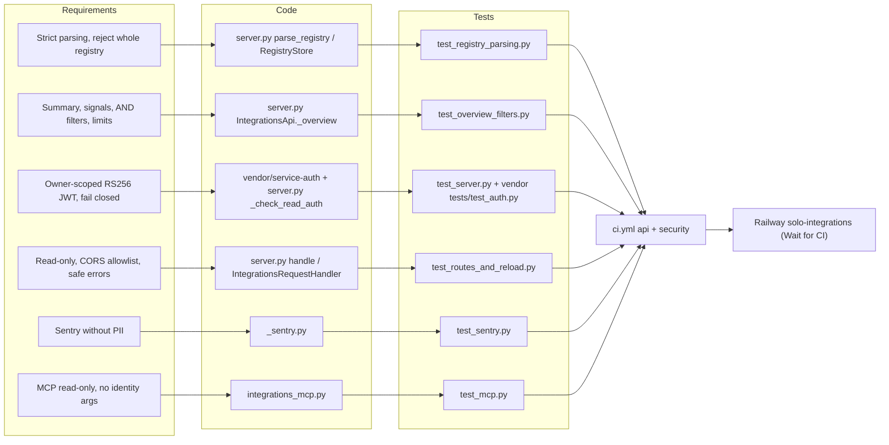

# 04 — Traceability (RTM)

Requirement มาจาก `PRODUCT.md` (Capabilities and Constraints) และ `specs/001-l2-baseline/spec.md` (AC-01…AC-11) ทุก test รันใน workflow `CI` job `api` (ci-python @ `87dc5e1c`, v1.1.1) และ deploy โดย Railway Wait for CI

Sources: `PRODUCT.md`, `specs/001-l2-baseline/spec.md`, `server.py`, `_sentry.py`, `integrations_mcp.py`, `tests/*.py`, `.github/workflows/ci.yml`, `.railway/railway.ts`

| Req | Source | Code | Test | Release |
|---|---|---|---|---|
| AC-01 bad record rejects all | SPEC-001 | `parse_registry` | `test_registry_parsing.py::test_one_bad_record_rejects_the_whole_registry` | ci.yml → Railway |
| AC-02 duplicate id | SPEC-001 | `parse_registry` | `::test_duplicate_ids_reject_the_whole_registry` | same |
| AC-03 length cuts | SPEC-001, PRODUCT.md | `parse_registry` | `::test_long_values_are_cut_to_their_public_limits` | same |
| AC-04 connected = live + mcp_only | SPEC-001 | `_overview` | `test_overview_filters.py::test_summary_counts_connected_as_live_plus_mcp_only` | same |
| AC-05 AND filters | SPEC-001 | `_overview` | `::test_filters_combine_with_and` | same |
| AC-06 filter length 400 | SPEC-001 | `query_value` | `::test_a_filter_longer_than_its_limit_is_a_400` | same |
| AC-07 guide by id / prefix | SPEC-001 | `guide_path` | `::test_a_guide_is_found_by_full_id_or_by_the_id_prefix` | same |
| AC-08 reload on mtime | SPEC-001 | `RegistryStore.snapshot` | `test_routes_and_reload.py::test_the_registry_reloads_only_when_its_mtime_changes` | same |
| AC-09 generic 500 → Sentry | SPEC-001 | `handle` + `capture` | `::test_an_unexpected_error_is_a_generic_500_reported_to_sentry` | same |
| AC-10 origin refused | SPEC-001 | `_dispatch` | `::test_an_unlisted_origin_is_refused_before_routing` | same |
| AC-11 writes 405 | SPEC-001 | `handle` | `::test_every_write_method_is_refused_as_read_only` | same |
| JWT scope/tenant/sub, static token never prod | PRODUCT.md, contract | `check_read_auth`, `AuthPolicy` | `test_server.py::test_scoped_production_auth_and_safe_errors`, `::test_static_token_is_never_production_authorization`; vendor `test_auth.py` | same (vendor tests not in CI `testpaths`) |
| `/ready` + non-loopback bind fail closed | PRODUCT.md | `readiness`, `main` | `test_server.py::test_readiness_and_remote_bind_fail_closed` | Railway healthcheck `/ready` |
| Sentry no PII | PRODUCT.md | `_sentry.py` | `test_sentry.py` (8 tests) | same |
| MCP read-only, fixed errors, 60 s token | README | `integrations_mcp.py` | `test_mcp.py` (17 tests) | not deployed (local stdio) |
| Real registry parses | README | `parse_registry` | `test_server.py::test_real_registry_parses_every_record` | same |

## Gaps

- `vendor/service-auth/tests/test_auth.py` อยู่นอก `testpaths = ["tests"]` จึงไม่รันใน CI ของ repo นี้ (รันที่ `platform-auth-sdk`)
- SPEC-001 §4 Interfaces table เสีย (review 2026-10-24) — ยังไม่แก้
- PRODUCT.md "Measures" ไม่มี test/alert ผูกกับ `registry_unavailable` count

## Open questions

- SPEC-001 ยัง "owner approval pending"
