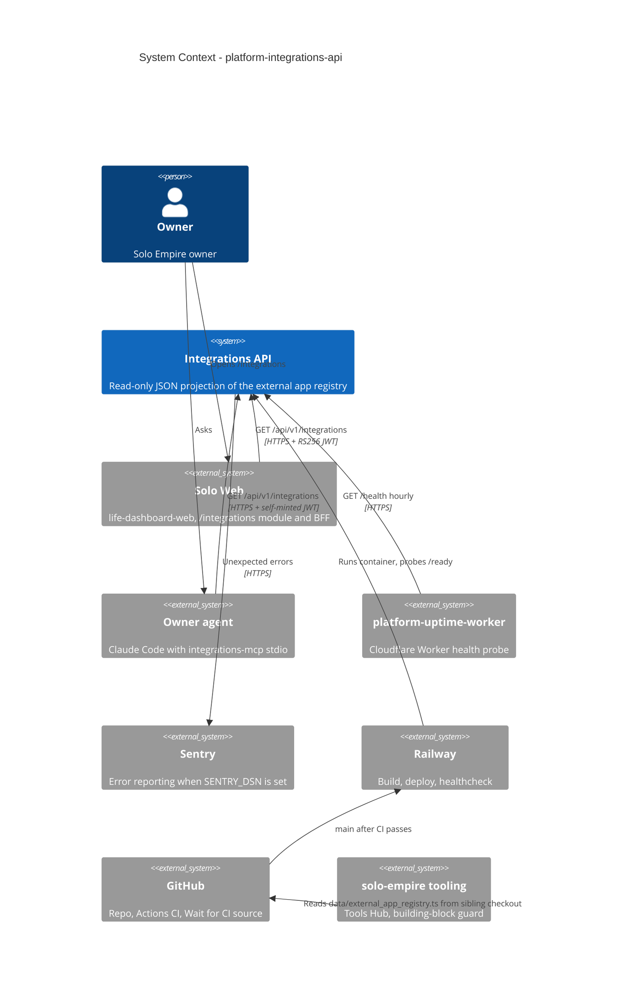

# 05 — C4 Context

Sources: `PRODUCT.md`, `README.md`, `server.py`, `_sentry.py`, `integrations_mcp.py`, `.railway/railway.ts`, `railway.toml`; life-dashboard-web @ `17159a9` `lib/backends.ts`; platform-uptime-worker @ `57f0afb` `src/targets.ts` (`integrations-api`, `SLEEPS`)

หมายเหตุ: API **ไม่** เรียก provider ภายนอกใด ๆ (Google, GitHub ฯลฯ) — ลิงก์ `apiDocs` เป็นแค่ข้อความ; ตัวเดียวที่มีการเรียก Google คือ `integrations/google/setup_calendar.py` ซึ่งเป็น owner script local ไม่ได้อยู่ใน image

## Open questions

- gateway (`gateway.bookchaowalit.com`) มี route `integrations` แต่ไม่ได้วาดเป็น caller เพราะยังไม่เห็น caller จริง
