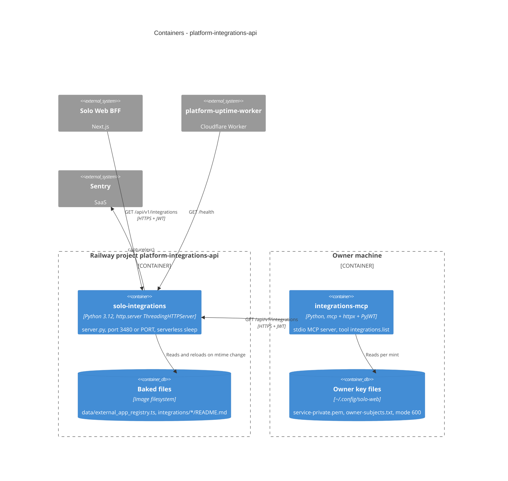

# 06 — C4 Container

Sources: `Dockerfile`, `railway.toml`, `.railway/railway.ts`, `server.py`, `integrations_mcp.py`, `.mcp.json`, `pyproject.toml`, `_sentry.py`, `service.yaml` (`data.reads`, `writes: []`)
