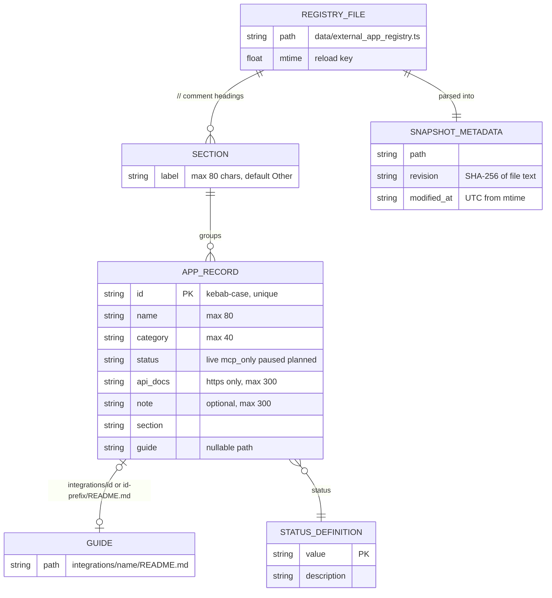

# 09 — ERD

ไม่มี database (`service.yaml` `writes: []`, `PRODUCT.md` "No database") — persisted data คือไฟล์ทะเบียนที่ bake เข้า image ภาพนี้คือ data model ของไฟล์ + snapshot in-memory + payload

Sources: `data/external_app_registry.ts` (`ExternalAppRecord`), `server.py` (`parse_registry`, `guide_path`, `RegistryStore.snapshot`, `STATUS_DEFINITIONS`, `SAFE_ID_RE`), `contracts/integrations.v1.md`

ค่าจริง ณ `75d28a4`: 106 records — `live` 26, `mcp_only` 3, `paused` 2, `planned` 75 (`grep -c "status: '<s>'" data/external_app_registry.ts`); guide 8 โฟลเดอร์ใน `integrations/` (brave-bookmarks, discord, google, line, microsoft-graph, monday, whatsapp-business, zoom)

นอก service: MCP อ่านไฟล์ owner `~/.config/solo-web/service-private.pem`, `owner-subjects.txt`, `~/.config/empire-platform/client.env` (`integrations_mcp.py`) — ไม่ได้เก็บใน repo
