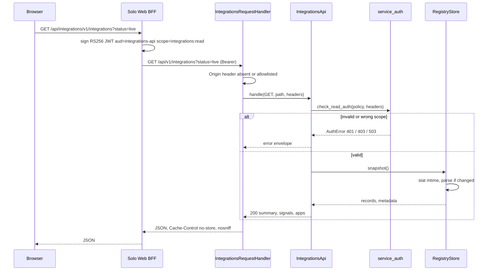
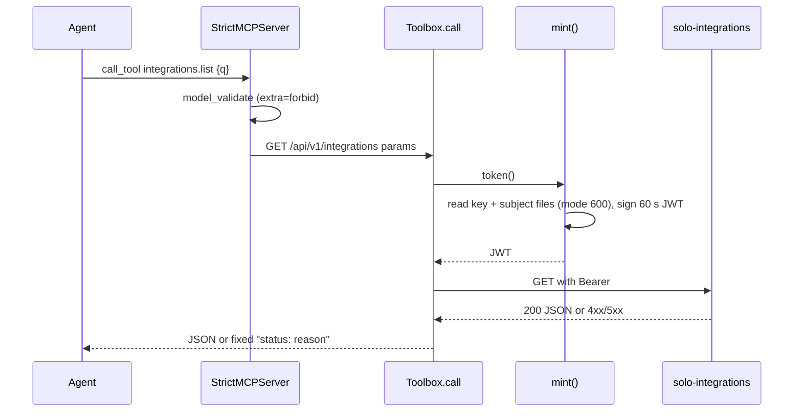
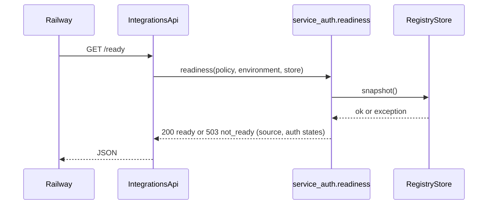

# 10 — Sequences

## 1. Owner อ่าน catalog ผ่าน Solo Web BFF

Sources: `server.py`, `vendor/service-auth/service_auth/__init__.py`; life-dashboard-web @ `17159a9` `lib/backends.ts`, `lib/auth.ts`

## 2. Agent ผ่าน integrations-mcp

Sources: `integrations_mcp.py`, `tests/test_mcp.py`

## 3. Railway deploy healthcheck (/ready)

Sources: `railway.toml`, `server.py` `_ready`, `vendor/service-auth/service_auth/__init__.py` `readiness`
