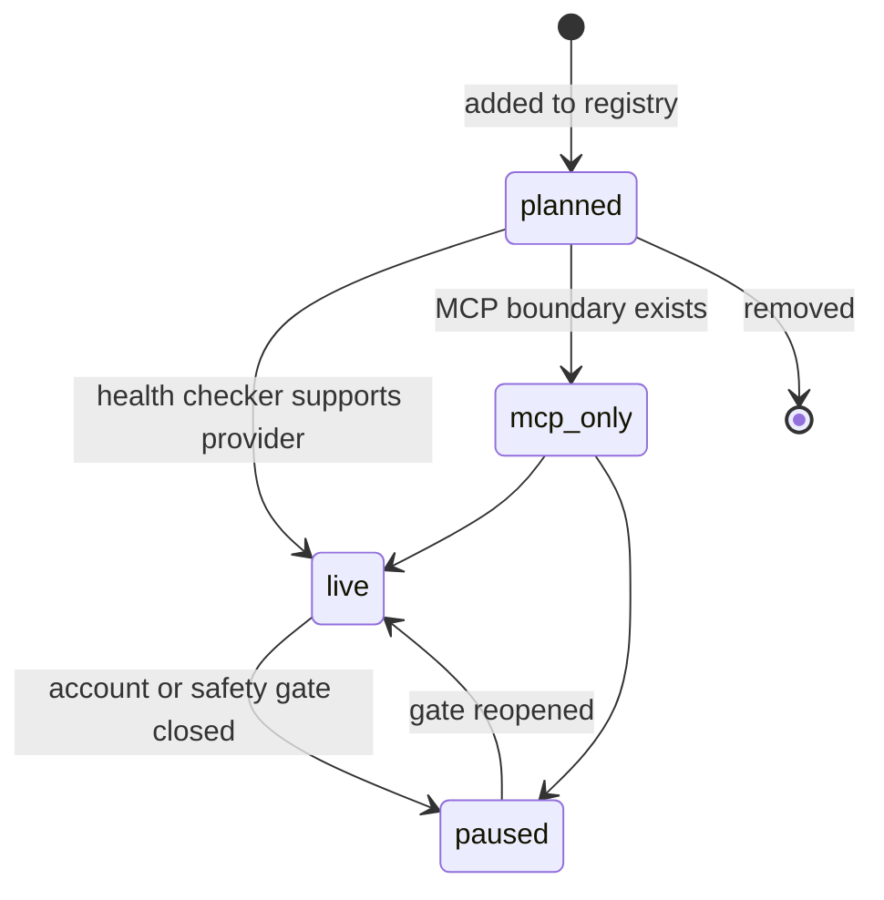
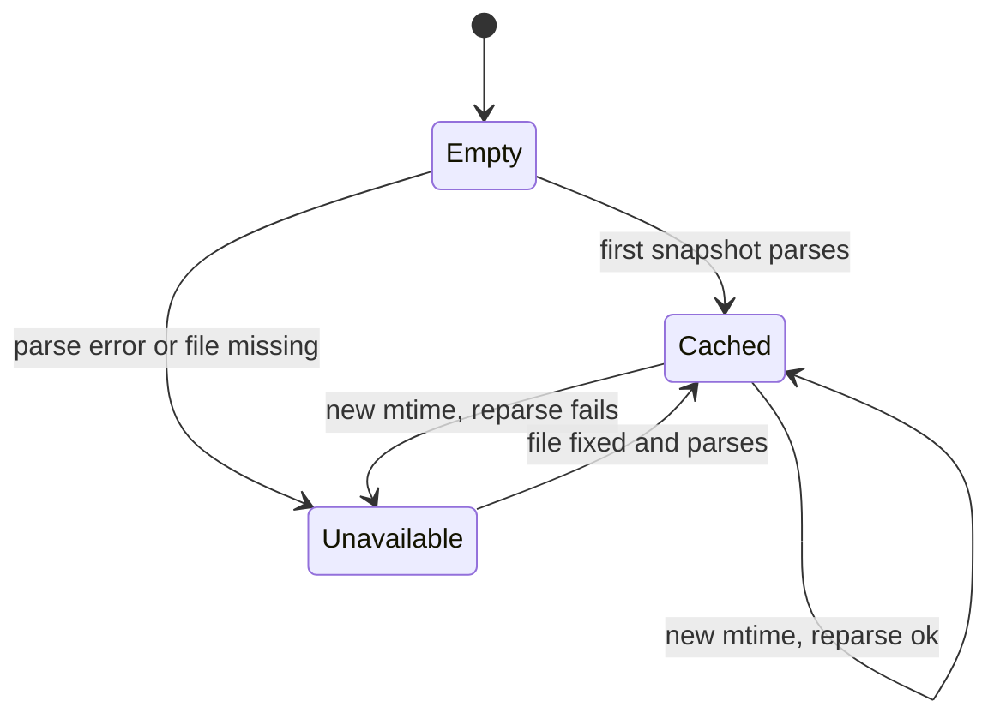
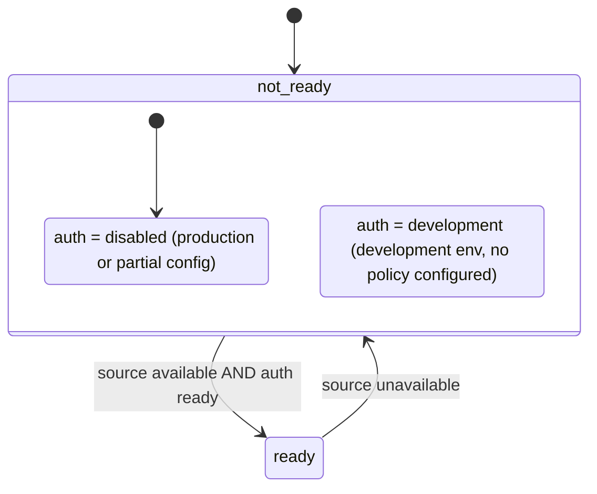

# 11 — State machines

ไม่มี entity ที่เปลี่ยนสถานะ runtime (read-only, ไม่มี DB) แต่มี lifecycle ที่โค้ดและเอกสารกำหนด

## App record status (เปลี่ยนโดยแก้ไฟล์ทะเบียน)

Sources: `server.py` `STATUSES`, `STATUS_DEFINITIONS`; `docs/EXTERNAL-APP-REGISTRY.md` (Status meanings, promotion rule); `data/external_app_registry.ts` header comment

หมายเหตุ: transition ไม่ได้ถูกบังคับในโค้ด — parser ตรวจแค่ค่าอยู่ใน 4 ค่า; ลูกศรมาจากคำอธิบายในเอกสาร

## Registry snapshot (RegistryStore)

Sources: `server.py` `RegistryStore.snapshot` (cache set only after successful parse), `tests/test_routes_and_reload.py::test_the_registry_reloads_only_when_its_mtime_changes`, `::test_a_missing_registry_is_a_503_not_a_partial_list`

## Readiness (`/ready`)

`status` เป็น `ready` (200) ได้ทางเดียวคือ source parse ได้และ JWT policy ready; `auth=development` ยังคืน 503

Sources: `vendor/service-auth/service_auth/__init__.py` `readiness`, `contracts/integrations.v1.md`

## Open questions

- เมื่อ mtime เปลี่ยนแล้ว parse ล้มเหลว `_snapshot` เก่ายังอยู่แต่ `snapshot()` raise ทุกครั้ง (ไม่ fallback cache) — ตั้งใจหรือไม่ (ใน image ไฟล์ไม่เปลี่ยนจึงเกิดได้เฉพาะ local)
