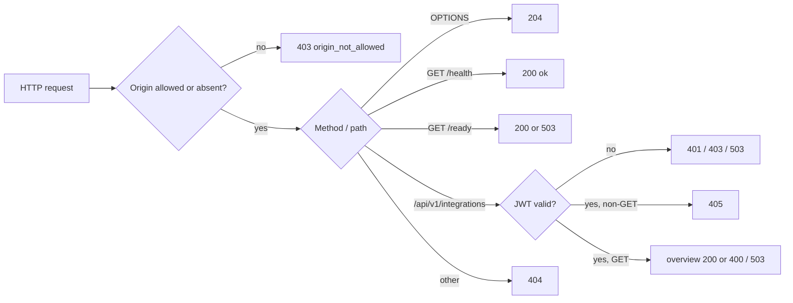

# 12 — API & integrations

**Reused:** contract หลักคือ [`contracts/integrations.v1.md`](../../contracts/integrations.v1.md) (routes, response fields, auth, readiness) — ไฟล์นี้สรุปเป็นภาพและเพิ่มสิ่งที่ contract ไม่ได้เขียน (`/ready` route table, OPTIONS, error codes, MCP)

## Endpoints

| Method | Path | Auth | Responses |
|---|---|---|---|
| GET | `/health` | none | 200 `{status, service, schema_version, timestamp}` |
| GET | `/ready` | none | 200 / 503 `{status, source, auth}` |
| GET | `/api/v1/integrations?status=&category=&q=` | RS256 JWT | 200; 400 `invalid_field`; 401 `unauthorized`; 403 `forbidden`; 503 `reads_disabled` / `registry_unavailable`; 500 `internal_error` |
| POST/PUT/PATCH/DELETE | `/api/v1/integrations` | JWT checked first | 405 `method_not_allowed` |
| OPTIONS | any | none | 204, `Allow-Methods: GET, OPTIONS` |
| any | other path | — | 404 `not_found` |
| any | any, disallowed `Origin` | — | 403 `origin_not_allowed` |

Sources: `server.py` (`handle`, `_dispatch`, `_write`), `contracts/integrations.v1.md`, `tests/test_routes_and_reload.py`

Sources: `server.py`

## Integrations (external)

| Integration | Direction | Where | Notes |
|---|---|---|---|
| Solo Web BFF | inbound caller | life-dashboard-web `lib/backends.ts` | env `INTEGRATIONS_API_ORIGIN` |
| integrations-mcp | inbound caller (local) | `integrations_mcp.py` | env `EMPIRE_INTEGRATIONS_API` |
| platform-uptime-worker | inbound probe | uptime `src/targets.ts` | `/health`, hourly (`SLEEPS`) |
| Sentry | outbound | `_sentry.py` | only with `SENTRY_DSN` |
| Google Calendar OAuth | outbound, owner script only | `integrations/google/setup_calendar.py` | not in image; writes `~/.config/solo-empire/integrations/google/` |
| 106 providers in registry | none | `data/external_app_registry.ts` | `apiDocs` links only; API never calls them |

ไม่มี webhook ใน repo นี้ (คู่มือ `integrations/line/README.md` ฯลฯ เป็นเอกสารจาก solo-empire)

## Open questions

- `docs/EXTERNAL-APP-REGISTRY.md` ยังอธิบาย route เก่า `GET /api/integrations/health` ของ `infra/api` ที่ retire แล้ว — ควรย้ายเป็น historical ให้ชัดกว่านี้หรือไม่
