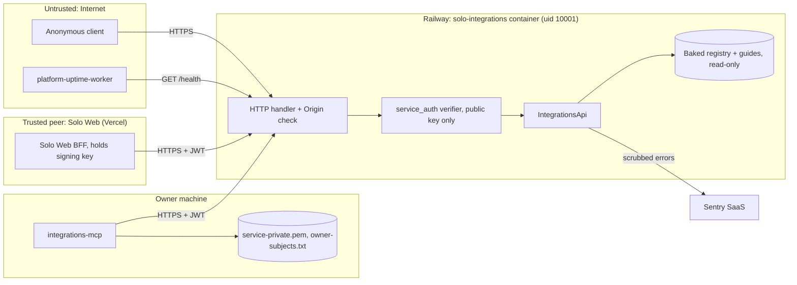

# 13 — Threat model (DFD + STRIDE)

Sources: `server.py`, `vendor/service-auth/service_auth/__init__.py`, `integrations_mcp.py`, `_sentry.py`, `Dockerfile` (`useradd --uid 10001`, `USER app`), `README.md`

## STRIDE

| Element | Threat | Existing mitigation (code) | Gap |
|---|---|---|---|
| HTTP handler | **S** forged caller | RS256 only, local public key, rejects remote key headers, checks claims `iss`, `aud`, `sub`, `tenant` and `scope`, ≤120 s + `jti` required (`service_auth`) | `jti` only format-checked (`service_auth` lines ~157-161), no replay store, so a captured JWT can be replayed until it expires (at most 120 s) |
| HTTP handler | **T** tamper query | length limits 40/80 → 400 (`query_value`) | — |
| HTTP handler | **R** no audit of reads | — | `log_message` returns nothing: ไม่มี access log เลย |
| HTTP handler | **I** error leaks | fixed error messages; 500 never echoes text; `Cache-Control: no-store`, `nosniff` | — |
| HTTP handler | **D** flood / large request | ThreadingHTTPServer; serverless | ไม่มี rate limit ใน service |
| HTTP handler | **E** write | all non-GET → 405; no write path exists | — |
| CORS | browser cross-origin read | Origin allowlist `INTEGRATIONS_API_CORS_ORIGINS`, refused before routing | production ไม่ได้ตั้ง variable นี้ → default localhost:3600 (ปลอดภัยแต่ควรระบุ) |
| Auth config | misconfig opens reads | partial config fails closed; non-loopback bind requires ready policy; static token never in production; Dockerfile sets `INTEGRATIONS_API_ENV=production` | development mode with no policy and no token allows reads (`check_read_auth` returns None) — local only |
| Registry file | **T** malicious edit | strict parser, https-only docs, safe id regex, duplicate check; change via git + CI | no CODEOWNERS / branch protection evidence in repo |
| Container | **E** | non-root uid 10001, slim image, frozen lock | — |
| integrations-mcp | **S/E** key misuse | key/subject files must be mode 600; token 60 s fixed aud/scope; no identity args; unknown args rejected | key can mint for every Solo Web service (README trade-off) |
| integrations-mcp | **I** | errors fixed from status; token with whitespace refused without echo | — |
| Sentry | **I** PII/secret leakage | no PII, no locals, no request data, scrub bearer/JWT/URL passwords, no tracing | — |
| Supply chain | **T** | `uv.lock --frozen`, SHA-pinned reusable CI, gitleaks/semgrep/osv/trivy, Renovate | vendored service-auth is a manual copy |

## Open questions

- ยอมรับ replay ภายใน 120 s ได้หรือไม่ (read-only data)
- มี branch protection / required review บน `main` หรือไม่ (ไม่อยู่ใน repo)
