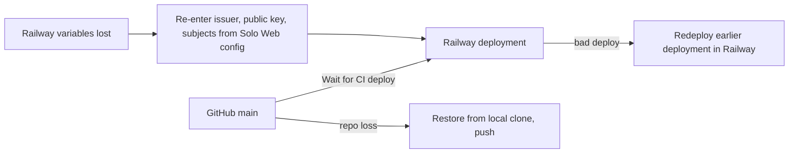

# 14 — Backup & DR

## ข้อมูลที่มี

| Data | Where | Source of truth | Backup reality |
|---|---|---|---|
| Registry `data/external_app_registry.ts` | Git (GitHub `bookchaowalit/platform-integrations-api`) + baked in image | Git | Git history + clones (original clone, worktrees); ไม่มี backup workflow เฉพาะ |
| Guides `integrations/*/README.md` | Git + image | snapshot from solo-empire `integrations/` (README) | Git |
| Runtime state | in-memory snapshot only | — | none needed (rebuilt from file) |
| Railway variables (auth issuer, public key, subjects, Sentry) | Railway service | Railway | not in repo; public key/issuer re-creatable from Solo Web |
| MCP key files | owner machine `~/.config/solo-web/` | Solo Web | outside this repo |

ไม่มี database (`service.yaml` `writes: []`) — memory record "nightly encrypted DB backups" ไม่เกี่ยวกับ service นี้

Sources: `service.yaml`, `Dockerfile`, `README.md` (Deploy: "Roll back by redeploying an earlier deployment in Railway"), `.railway/railway.ts` (`variables: { managed: false }`), Railway variable names (`railway variables --json` keys, 2026-11-04)

## RTO / RPO

- RTO: **not defined**. ข้อมูลจริง: deploy ปกติ build Dockerfile จาก main; rollback = redeploy deployment เก่า
- RPO: **not defined**; โดยธรรมชาติ = commit ล่าสุดบน GitHub (ไม่มี data เขียนตอน runtime)

## Open questions

- ต้องการ RTO เป็นตัวเลขหรือไม่ (service ถูกใช้โดย owner เท่านั้น)
- Railway variables ไม่มีใน IaC (`managed: false`) — จะบันทึกชื่อ/แหล่งที่มาไว้ที่ไหนสำหรับ DR
