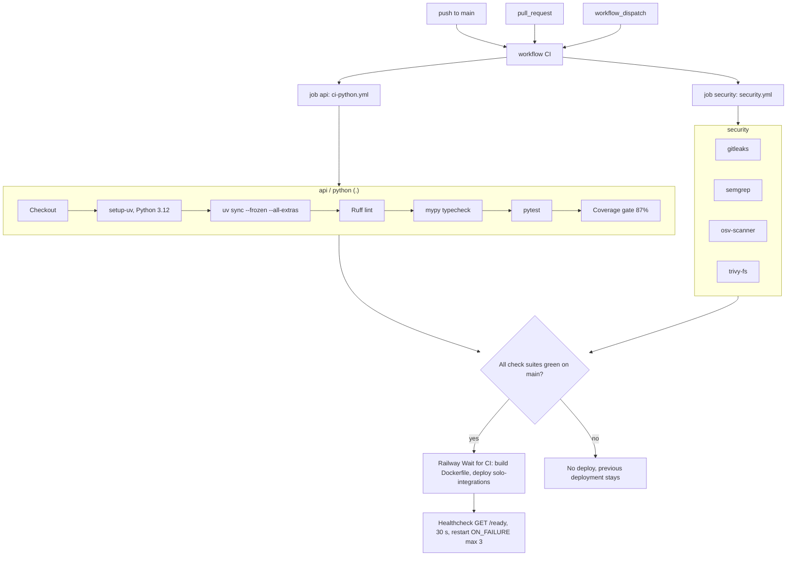

# 15 — CI/CD pipeline

workflow เดียว: `.github/workflows/ci.yml` (`CI`) เรียก reusable workflows ของ `bookchaowalit/platform-ci-workflows` pin ที่ SHA `87dc5e1c` (v1.1.1); runner GitHub-hosted (repo public)

Sources: `.github/workflows/ci.yml`, platform-ci-workflows @ `87dc5e1c` `.github/workflows/ci-python.yml` (steps Checkout, Set up uv and Python, Install dependencies, Lint (Ruff), Typecheck, Test, Coverage gate; Postgres steps not used here) and `security.yml` (jobs `gitleaks`, `semgrep`, `osv-scanner`, `trivy-fs`), `.railway/railway.ts` (`checkSuites: true`), `.railway/railway.ts`, `renovate.json`

อื่น ๆ: concurrency `ci-${{ github.ref }}` cancel-in-progress; `permissions: contents: read`; Renovate จันทร์ก่อน 9 โมง (Asia/Bangkok), group `platform-ci-workflows`

ตัวอย่างจริง: run บน `2280bfc` (2026-10-22) `security / osv-scanner` failure → แก้ด้วย `b38d8e9` (certifi, PYSEC-2026-4320) 16 นาทีต่อมา (`gh run list`)
