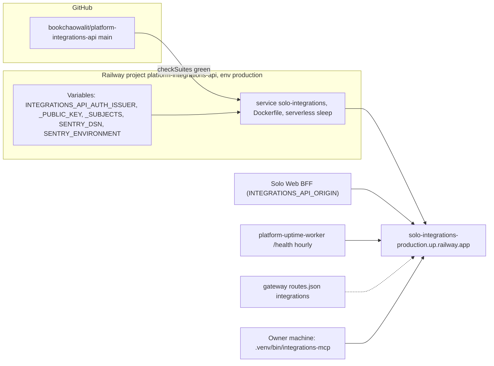

# 16 — Deployment

Sources: `.railway/railway.ts`, `.railway/railway.ts`, `Dockerfile`, `PRODUCT.md` (Operating Context: URL, Singapore, serverless), `README.md`, Railway `railway variables --json` key names and `railway deployment list` (2026-11-04), platform-uptime-worker @ `57f0afb` `src/targets.ts`, platform-api-gateway @ `1f02c2a` `routes.json`, life-dashboard-web @ `17159a9` `lib/backends.ts`

| Item | Value |
|---|---|
| Image | `python:3.12-slim` + uv 0.13.1, venv `/opt/venv`, user `app` uid 10001 |
| Listener | `0.0.0.0`, `INTEGRATIONS_API_PORT` → `PORT` → 3480 |
| Env baked | `INTEGRATIONS_API_ENV=production`, `INTEGRATIONS_API_HOST=0.0.0.0` |
| Health | Railway `/ready` (30 s); Docker `HEALTHCHECK` `/ready` every 15 s |
| Region | Singapore (`PRODUCT.md`; IaC comment `asia-southeast1-eqsg3a=1`) |
| Live check 2026-11-04 | `/health` 200 (1.2 s, cold), `/ready` `{"status":"ready","source":"available","auth":"ready"}`, `/api/v1/integrations` without token 401 |
| Current deployment | `75d28a4`, status SLEEPING (redeploy 2026-10-30) |

`service.yaml` ยังเขียน `deploy.target: unassigned` ซึ่งไม่ตรงกับ production จริง

## Open questions

- ไม่มี custom domain; จะย้าย consumer ไปผ่าน `gateway.bookchaowalit.com/v1/integrations` หรือไม่
- อัปเดต `service.yaml` `deploy.target` ให้เป็น railway หรือไม่
