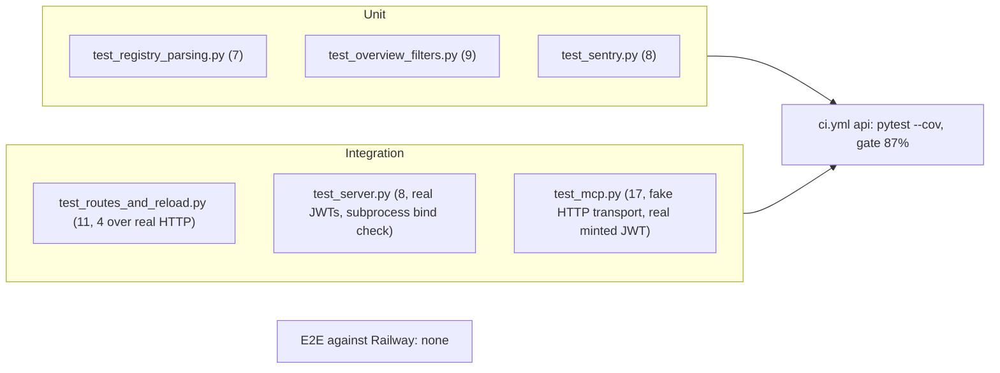

# 17 — Test coverage matrix

นิยามระดับในไฟล์นี้: **unit** = เรียก function/`IntegrationsApi.handle` ตรง ๆ กับ fixture ไฟล์ชั่วคราว; **integration** = ผ่าน socket จริง (`ThreadingHTTPServer` บน 127.0.0.1 หรือ subprocess `server.py`) หรือ JWT จริงที่เซ็นด้วย key ชั่วคราว; **e2e** = เรียก deployment จริง — ไม่มีใน repo

Sources: `tests/*.py`, `pyproject.toml` (`testpaths`, `[tool.coverage.run]`), `.github/workflows/ci.yml`

| Feature | Unit | Integration | E2E | Test files |
|---|---|---|---|---|
| Registry parsing, strict reject, limits, sections, escaping | ✅ | ✅ (real registry parses) | — | `test_registry_parsing.py`, `test_server.py::test_strict_parsing_fails_closed`, `::test_real_registry_parses_every_record` |
| Overview summary, signals, filters, guides, boundary text | ✅ | ✅ | — | `test_overview_filters.py`, `test_server.py::test_overview`, `::test_filters` |
| Routing, 404/405, OPTIONS, reload on mtime, 503, 500→Sentry | ✅ | — | — | `test_routes_and_reload.py` |
| HTTP headers, CORS allow/refuse, preflight | — | ✅ | — | `test_routes_and_reload.py` (`http_server` fixture) |
| JWT auth scope/tenant/sub, static token never prod | — | ✅ | — | `test_server.py` |
| `/ready` and non-loopback bind fail closed | — | ✅ | — | `test_server.py::test_readiness_and_remote_bind_fail_closed` |
| Sentry init, scrub, capture | ✅ | — | — | `test_sentry.py` |
| MCP tool list, strict args, fixed errors, minting, URL rules | — | ✅ | — | `test_mcp.py` |
| service_auth verifier | (in `vendor/service-auth/tests/test_auth.py`, not in CI testpaths) | — | — | — |
| Dockerfile build / Railway deploy | — | — | **gap** | README mentions "image rehearsal" (SPEC-001 NFR), no automated test |
| Live `/health` after deploy | — | — | **gap** | only uptime worker probe, no deploy-smoke workflow |

Coverage: threshold 87%, measured 89.96% on 2026-10-22 (`ci.yml` comment, SPEC-001 §6)

## Gaps

- ไม่มี e2e / post-deploy smoke
- vendor tests ไม่ได้รันใน CI ของ repo นี้
- `integrations/google/setup_calendar.py` ไม่มี test (excluded from mypy)
