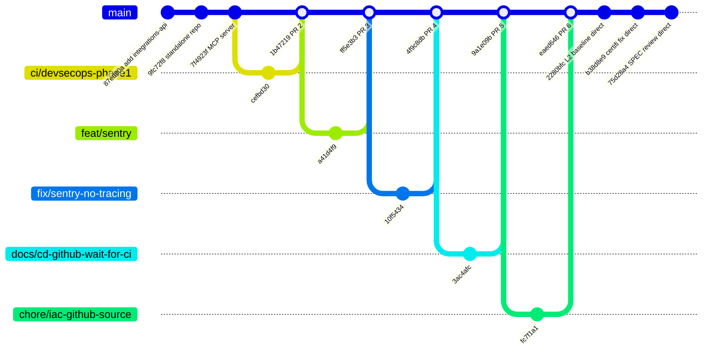
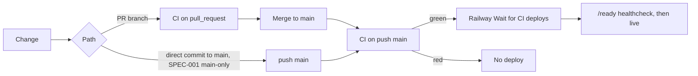

# 18 — Git & release workflow

Sources: `git log origin/main` (31 commits 2026-10-04 → 2026-10-24), `gh pr list -R bookchaowalit/platform-integrations-api --state all` (PR #2–#6 merged, #1 open)

gitGraph แสดง commit ตัวแทนบางตัว ไม่ใช่ทุก commit (PR #3, #4 squash/merge ลง main เป็น commit เดียว)

## How a change reaches production

Sources: `.github/workflows/ci.yml`, `.railway/railway.ts`, `specs/001-l2-baseline/spec.md` ("Main-only: yes"), `README.md` Deploy

- ไม่มี tag / GitHub release; version ใน `pyproject.toml` ยังเป็น `0.1.0`; Sentry `release` = `RAILWAY_GIT_COMMIT_SHA` (`_sentry.py`)
- rollback: redeploy deployment เก่าใน Railway (README)

## Open questions

- นโยบายหลักคือ PR หรือ main-only? ทั้งสองแบบมีใน history
