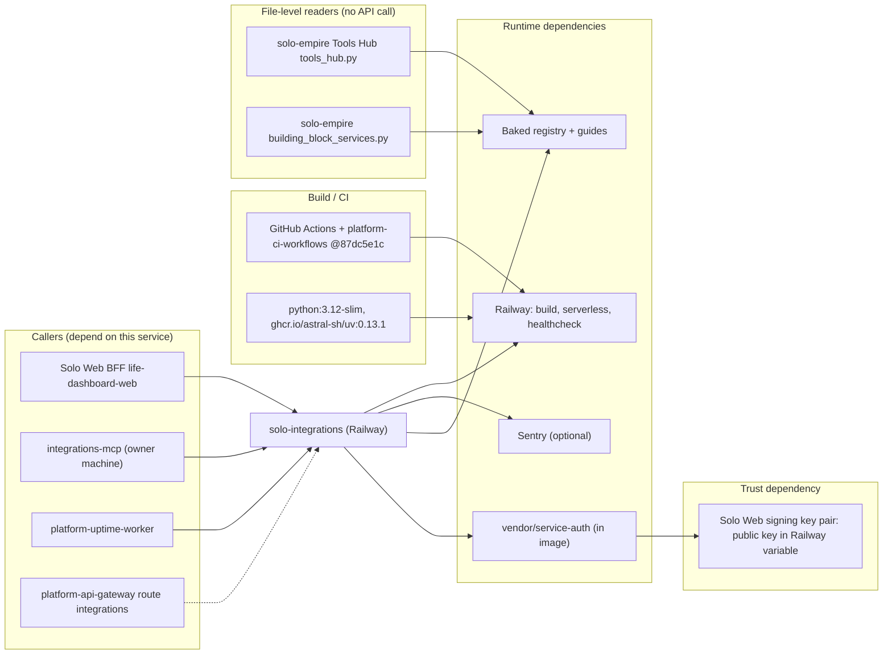

# 19 — Service dependency map

Sources: `server.py`, `Dockerfile`, `pyproject.toml`, `_sentry.py`, `.railway/railway.ts`, `.github/workflows/ci.yml`, `README.md` (Tools Hub, building-block guard, `SOLO_INTEGRATIONS_ROOT`), `integrations_mcp.py`; life-dashboard-web @ `17159a9` `lib/backends.ts`; platform-uptime-worker @ `57f0afb` `src/targets.ts`; platform-api-gateway @ `1f02c2a` `routes.json`

ไม่มี DB, cache, queue หรือ CDN; ไม่มีการเรียก provider ภายนอก ถ้า Sentry ล่ม service ยังทำงาน (capture เป็น best effort)

## Open questions

- gateway route เป็น dependency จริงหรือแค่ registry entry (เส้นประ)
