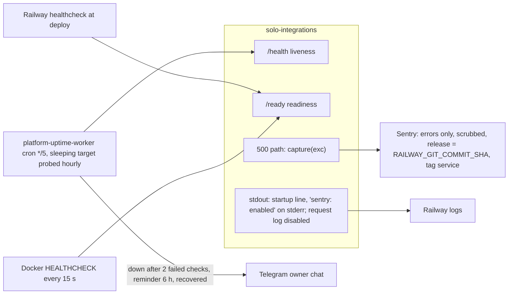

# 20 — Observability

Sources: `server.py` (`log_message` returns nothing, `print(... running on ...)`, `capture`), `_sentry.py`, `.railway/railway.ts`, `Dockerfile` (`HEALTHCHECK`), `PRODUCT.md` (Operating Context, Measures); platform-uptime-worker @ `57f0afb` `src/targets.ts` (`integrations-api`, `SLEEPS`), `src/monitor.ts` (`FAILURES_BEFORE_DOWN = 2`, `REMINDER_HOURS = 6`), `src/worker.ts` (Telegram), `wrangler.toml` (crons)

| Signal | Watched by | Covered | Not covered |
|---|---|---|---|
| Liveness | uptime worker `/health` | process up | `/health` ไม่ตรวจ registry/auth |
| Readiness | Railway healthcheck at deploy, Docker HEALTHCHECK | registry parses, auth configured | ไม่มี monitor ภายนอกเรียก `/ready` หลัง deploy |
| Errors | Sentry | unexpected 500 | 503 `registry_unavailable`, 401/403 ไม่ถูกส่ง |
| Requests / latency | — | — | ไม่มี access log, metric หรือ tracing |
| Registry freshness | `source.revision`, `modified_at` in payload | — | ไม่มี alert |

PRODUCT.md Measures ("Registry parse failures in production, target 0", "5xx rate") ยังไม่มีตัววัดอัตโนมัติ: 503 ไม่ถูกนับที่ไหน

## Open questions

- uptime worker ควร probe `/ready` แทน `/health` หรือไม่ (จะจับ registry/auth เสียได้)
- ใครดู Sentry issue ของ service นี้ และมี alert rule หรือไม่ (ไม่อยู่ใน repo)
