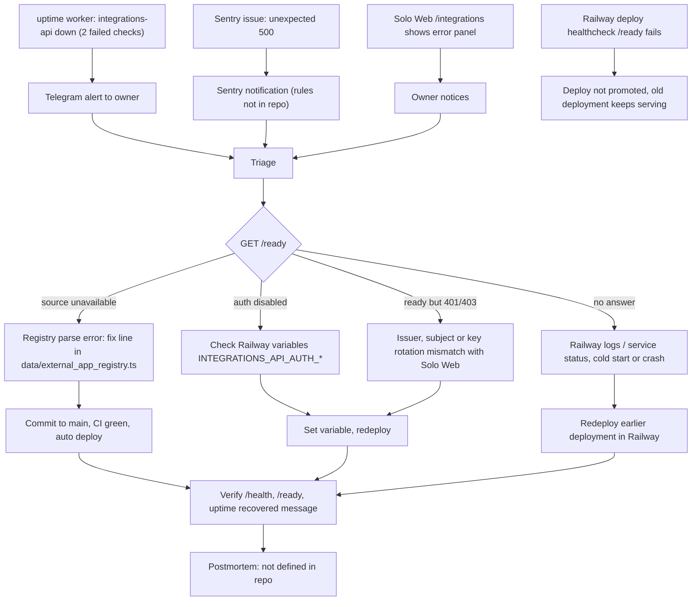

# 21 — Incident response

ไม่มี runbook ใน repo; flow นี้ประกอบจากช่องทางที่มีจริง (uptime Telegram, Sentry, Railway healthcheck/rollback, CI gate)

Sources: platform-uptime-worker @ `57f0afb` `src/monitor.ts`, `src/worker.ts`; `_sentry.py`; `server.py` error codes; `vendor/service-auth/service_auth/__init__.py` `readiness`; `.railway/railway.ts`; `README.md` (rollback, key rotation)

## Open questions

- ไม่มี postmortem template / severity นิยามสำหรับ service นี้
- Sentry alert rule และผู้รับ notification ไม่อยู่ใน repo
