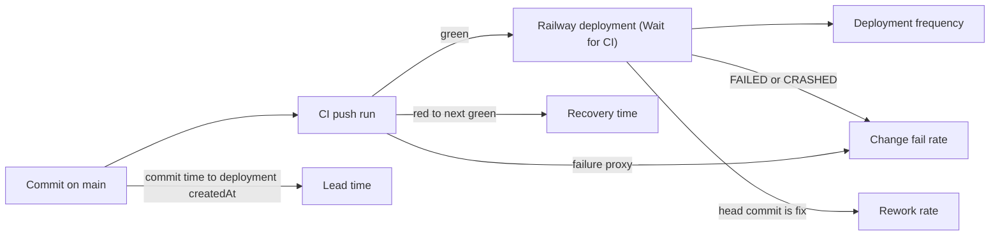

# 22 — DORA metrics

ช่วงวัด: 90 วัน **2026-08-06 → 2026-11-04** (วัด 2026-11-04) — repo เริ่ม 2026-10-04 (subtree split จาก solo-empire) จึงมีข้อมูลจริงแค่ ~1 เดือน
**นิยาม deployment:** Railway deployment ของ project `platform-integrations-api` service `solo-integrations` env production (`railway deployment list`) — ทั้งหมด 10 รายการ: 7 `deploy`, 3 `redeploy`; ตั้งแต่ 2026-10-18 11:13 UTC deploy มาจาก GitHub (มี commit hash), ก่อนหน้านั้นเป็น CLI upload (ไม่มี hash)

| Metric | How measured | Value | Command |
|---|---|---|---|
| Deployment frequency | Railway deployments in window | **10 in 4 active days** (10-12 ×3, 10-18 ×5, 10-24 ×1, 10-30 ×1 redeploy) ≈ 0.8/week; current `SLEEPING` = `75d28a4` | `railway link -p <project> -s solo-integrations -e production && railway deployment list --json` |
| Lead time for changes | main commit author time → first deployment containing it, GitHub-source era (7 main commits from 2026-10-18 CD) | **median 3.5 min**; min 10 s (`9a1e09b`, `eaed646`); max **~56 h** (`2280bfc`, `b38d8e9` of 2026-10-22, first deployed with `75d28a4` on 10-24) | `git log origin/main --since=2026-10-18 --format='%h %aI %s'` + deployment list |
| Change fail rate | (a) deployments FAILED/CRASHED; (b) proxy: CI push runs on `main` = failure | (a) **0 / 10 = 0 %**; (b) **1 / 8 = 12.5 %** (`2280bfc`, `security / osv-scanner`) | `gh run list -R bookchaowalit/platform-integrations-api --limit 100 --json event,headBranch,conclusion,createdAt,headSha` |
| Failed deployment recovery time | production: no failed deployment → **not measurable**; CI proxy red → next green on main | CI: **15 min 56 s** (`2280bfc` 01:44:29 → `b38d8e9` 02:00:25 UTC, 2026-10-22) | same `gh run list` |
| Deployment rework rate | deployments whose head commit subject starts `fix` | **2 / 10 = 20 %** (`4f9c8db` CLI 08:41 UTC by time pairing, and GitHub deploy 11:13 UTC, both 2026-10-18); commit level 4 / 31 = 13 % `^(fix\|revert)` | `git log origin/main --since="90 days ago" --format=%s \| grep -ciE '^(fix\|revert)'` |

Sources: `git log origin/main` (31 commits), `gh run list` (17 runs, 8 push on `main`), `gh pr list --state all`, Railway `railway deployment list --json` (2026-11-04), `.railway/railway.ts`, `.github/workflows/ci.yml`

## Caveats

- deployment ก่อน 2026-10-18 ไม่มี commit hash → การจับคู่ใช้เวลา
- commit `2280bfc`/`b38d8e9` (2026-10-22) ไม่มี deployment ของตัวเอง แม้ CI ของ `b38d8e9` เขียว — สาเหตุไม่ได้บันทึกใน repo; ทำให้ lead time max สูง
- redeploy 2026-10-30 ไม่มี commit ใหม่ (สาเหตุไม่ระบุใน repo)

## Open questions

- ทำไม `b38d8e9` ไม่ถูก deploy ทันทีหลัง CI เขียว (2026-10-22 02:00 UTC)
- redeploy 2026-10-30 18:47 UTC มาจากใคร/เหตุใด
